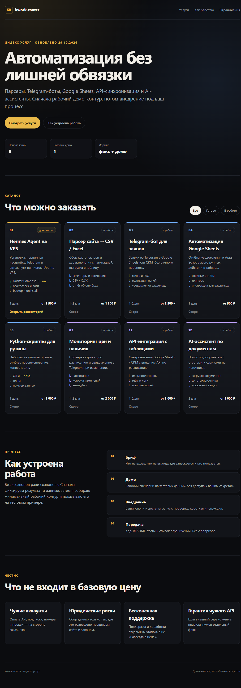

# kwork-router

Индекс услуг и демо-каталог для карточек на Kwork. Один статический сайт без сборки и зависимостей.



## Что здесь есть

- `index.html` — каталог из 8 направлений: Hermes/VPS, парсеры, Telegram-боты, Google Sheets, Python-утилиты, мониторинг, API-синхронизация, AI-ассистент.
- `styles.css` — адаптивная тёмная тема.
- `app.js` — фильтр «Все / Готово / В работе» без фреймворка.
- `data/services.json` — машинночитаемый реестр семейств и карточек.
- `docs/ARCHITECTURE.md` — как репозиторий связан с остальными `kwork-*`.
- `KWORK.md` — что именно обещается покупателю и что не входит в цену.
- `PORTFOLIO.md` — два кейса, которые можно показывать в переписке.
- `tests/test_catalog.py` — проверка реестра, HTML и отсутствия секретов.

## Быстрый запуск

```powershell
python -m http.server 8080
# открыть http://127.0.0.1:8080/
```

Или просто откройте `index.html` в браузере: внешних запросов и сборки нет.

## Проверка

```powershell
python -m unittest discover -s tests -v
```

Ожидаемо: все тесты проходят, внешние зависимости не нужны.

## Правила

- Карточка не считается готовой, пока под неё нет рабочего репозитория с демо и тестами.
- `status: active` только у направления с проверенным демо.
- В репозитории нет клиентских токенов, ключей и персональных данных.
- Цены и сроки — черновые, не публичная оферта.

## Связь с другими репозиториями

| Семейство | Репозиторий |
|---|---|
| Hermes/VPS | `kwork-hermes-vps` |
| Парсеры | `kwork-parser` |
| Telegram-боты | `kwork-tg-bot` |
| Google Sheets | `kwork-sheets` |
| Python-утилиты | `kwork-python-scripts` |
| Мониторинг | `kwork-monitor` |
| API-синхронизация | `kwork-api-sync` |
| AI-ассистенты | `kwork-ai-rag` |

Пока готов только `kwork-hermes-vps`. Остальные ведутся как отдельные репозитории, а не как папки внутри этого.
